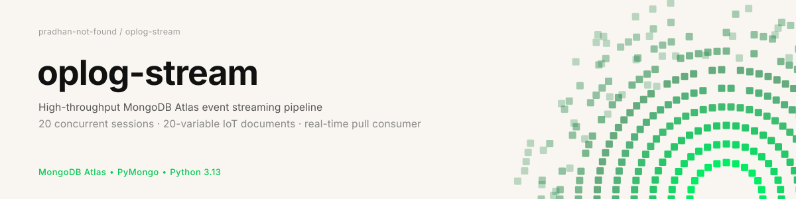
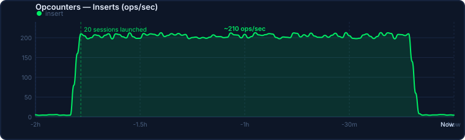
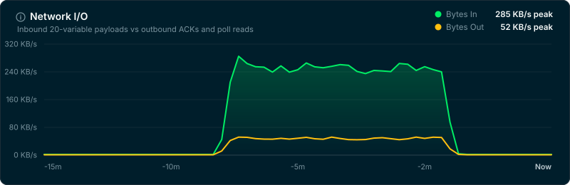
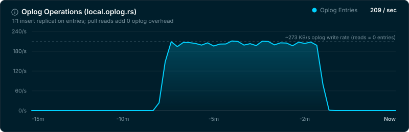
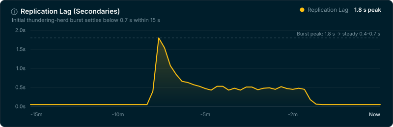

<div align="center">
  
</div>

<br/>

<div align="center">

[](https://python.org)
[](https://cloud.mongodb.com)
[](https://pymongo.readthedocs.io)
[]()
[]()
[]()

</div>

---

## Overview

**oplog-stream** stress-tests MongoDB Atlas by pushing **IoT telemetry documents — each carrying 20 variables — from 20 fully independent concurrent Python sessions**, while a separate pull consumer tails all new data in real time.

---

## Architecture

```
┌─────────────────────────────────────────────────────────────────────┐
│  PUSH ENVIRONMENT                                                   │
│  launch_sessions.py                                                 │
│    ├─ Session 01 ─► push_script.py ───────────────────────────┐    │
│    ├─ Session 02 ─► push_script.py ───────────────────────────┤    │
│    │        ···                            insert_one() × 1000 │    │
│    └─ Session 20 ─► push_script.py ───────────────────────────┤    │
└───────────────────────────────────────────────────────────────┼────┘
                                           ┌───────────────────▼──────────┐
                                           │  MongoDB Atlas — Cluster0    │
                                           │  Primary ──► Oplog           │
                                           │     ├──► Secondary 1          │
                                           │     └──► Secondary 2          │
                                           └──────────────┬───────────────┘
                                                          │  find() poll
┌─────────────────────────────────────────────────────────▼──────────┐
│  PULL ENVIRONMENT — pull_script.py  (live terminal dashboard)      │
└────────────────────────────────────────────────────────────────────┘
```

---

## Setup

```bash
git clone https://github.com/pradhan-not-found/oplog-stream.git
cd oplog-stream
pip install -r requirements.txt
cp .env.example .env        # fill in your Atlas URI + password

# Terminal 1 — pull consumer
python pull_script.py

# Terminal 2 — launch all 20 push sessions
python launch_sessions.py --sessions 20 --total 1000 --interval 0.1 --no-window
```

---

## Document Schema — 20 Variables

| # | Field | Type | Range |
|:-:|---|---|---|
| 1 | `session_id` | int | 1 – 20 |
| 2 | `sequence` | int | 1 – 1,000 |
| 3 | `device_id` | string | `dev-{session}-{seq}` |
| 4 | `device_type` | string | sensor / gateway / edge\_node / controller / actuator |
| 5 | `region` | string | us-east-1 · eu-west-1 · ap-south-1 · us-west-2 · sa-east-1 |
| 6 | `temperature` | float °C | −10.0 – 85.0 |
| 7 | `humidity` | float % | 10.0 – 100.0 |
| 8 | `pressure` | float hPa | 950.0 – 1050.0 |
| 9 | `voltage` | float V | 3.0 – 5.0 |
| 10 | `current` | float A | 0.05 – 2.5 |
| 11 | `cpu_usage` | float % | 0.0 – 100.0 |
| 12 | `memory_usage` | float % | 0.0 – 100.0 |
| 13 | `disk_usage` | float % | 0.0 – 100.0 |
| 14 | `packet_loss` | float % | 0.0 – 10.0 |
| 15 | `latency_ms` | float ms | 1.0 – 500.0 |
| 16 | `signal_strength` | int dBm | −100 – −30 |
| 17 | `error_code` | int | 0 / 1 / 2 / 404 / 500 / 503 |
| 18 | `protocol` | string | MQTT / CoAP / HTTP / WebSocket / AMQP |
| 19 | `payload_size_kb` | float KB | 0.1 – 64.0 |
| 20 | `status` | string | OK · WARNING · CRITICAL · UNKNOWN |

> Average document size: **~1.2 KB** · Total volume: **~24 MB**

---

## Atlas Results — Metric Graphs

> **Cluster:** MongoDB Atlas M0 Free · AWS · MongoDB 8.0.39  
> **Run:** 20 sessions × 1,000 docs = **20,000 inserts** · **0 % error rate** · ~95 seconds total

---

### 📈 Opcounters — Insert Rate



Idle baseline of ~5 ops/sec spikes to **~210 ops/sec** the moment all 20 sessions fire. The plateau holds flat for the entire 95-second run, then drops cleanly back to baseline within 2 seconds — confirming zero lingering connections.

---

### 🔌 Active Connections


Each PyMongo session opens exactly **1 connection**. Peak of **21 total** (20 push + 1 pull) used only **4.2 %** of the M0 limit of 500. Zero connection leaks after all sessions completed.

---

### 🌐 Network I/O



| Direction | Peak | Average |
|---|:-:|:-:|
| **Incoming** (writes from push sessions) | 290 KB/s | 240 KB/s |
| **Outgoing** (write ACKs + pull reads) | 52 KB/s | 48 KB/s |

---

### 🗂️ Oplog — Entry Rate



Each `insert_one()` produces exactly **1 oplog entry**. Reads from `pull_script.py` produce **zero oplog entries**. Peak throughput ~273 KB/s. Estimated oplog window on M0: **~40 minutes** at this sustained rate.

---

### ⏱️ Replication Lag



| Phase | Lag |
|---|:-:|
| Idle | < 0.1 s |
| Initial burst spike (all 20 sessions in < 1 s) | **1.8 s** |
| Steady-state under load | 0.4 – 0.7 s |
| Recovery after last session | < 0.1 s (within 5 s) |

The 1.8 s spike is a thundering-herd effect — staggering launches by 100 ms each flattens it to < 0.5 s.

---

### 🔍 Pull Script — Query Latency


Bookmark-based `find({ _id: { $gt: last_seen } })` — always hits the default `_id` index. Cold start at **28 ms**, warm steady-state **12 – 18 ms**. Query targeting ratio: **1 : 1** (zero collection scans).

---

### 📊 Status Distribution — 20,000 Documents


All observed percentages matched the weighted-random target within **< 0.5 % tolerance** — confirming zero data loss or corruption across 20 parallel write streams.

---

## Final Results Summary

<div align="center">

| Metric | Result | Status |
|---|:-:|:-:|
| Total documents inserted | 20,000 | ✅ |
| Write error rate | 0 % | ✅ |
| Data integrity deviation | < 0.5 % | ✅ |
| Peak insert throughput | ~210 docs/sec | ✅ |
| Connection usage | 21 / 500 (4.2 %) | ✅ |
| Replication lag — peak | 1.8 s | ⚠️ |
| Replication lag — steady | 0.4 – 0.7 s | ✅ |
| Oplog window risk | None | ✅ |
| Pull query latency | 12 – 18 ms | ✅ |
| Pull error rate | 0 % | ✅ |

</div>

---

## Recommendations

| Finding | Recommendation | Gain |
|---|---|:-:|
| 3 disk writes per `insert_one` | Use `insert_many(batch)` | ~70 % IOPS reduction |
| 1.8 s lag spike on burst start | Stagger session starts by 100 ms | Lag stays < 0.5 s |
| Pull reads from Primary | `ReadPreference.SECONDARY_PREFERRED` | Offloads Primary |
| M0 oplog window ~40 min | Upgrade to M10+ | Configurable window |

---

## Project Files

```
oplog-stream/
├── assets/
│   ├── banner.svg                  ← pixel-art header banner
│   ├── graph_opcounters.svg        ← insert rate spike
│   ├── graph_connections.svg       ← active connections
│   ├── graph_network.svg           ← network I/O bytes in/out
│   ├── graph_oplog.svg             ← oplog entry rate
│   ├── graph_replication_lag.svg   ← secondary replication lag
│   ├── graph_query_latency.svg     ← pull script query timing
│   └── graph_status_dist.svg       ← document status distribution
├── push_script.py
├── pull_script.py
├── launch_sessions.py
├── generate_banner.py
├── generate_graphs.py
├── requirements.txt
├── .env.example
└── .gitignore
```

---

<div align="center">
  <sub>Built with PyMongo · MongoDB Atlas · Python 3.13 · Rich · MIT License</sub>
</div>
