<div align="center">
  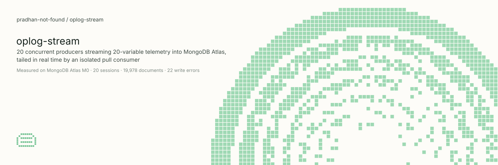
  <br/><br/>
  &nbsp;
  &nbsp;
  &nbsp;
  &nbsp;
  
  <br/><br/>
</div>

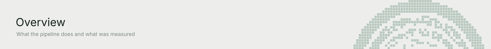

**oplog-stream** is a multi-session event streaming test for MongoDB Atlas. Twenty independent Python producer processes each generate 20-variable telemetry documents in a loop and insert them into one collection. A pull consumer runs as a separate process in its own environment and tails new documents as they arrive.

Every chart and number in this README comes from one recorded run on 25 November 2026 (06:04:40 to 06:14:51 UTC). The raw data is committed in [`results/`](results/). The charts are rendered from it by [`generate_graphs.py`](generate_graphs.py), and nothing in them is synthesised or hand-tuned.


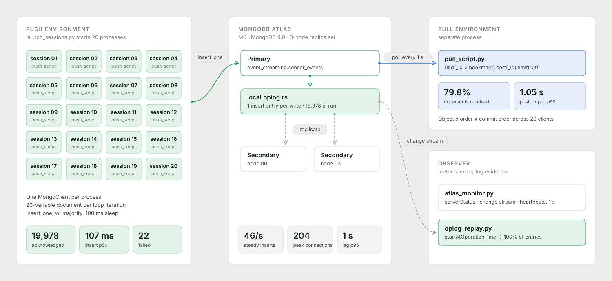

<table width="100%">
  <tr><th align="left">Component</th><th align="left">Role</th></tr>
  <tr><td align="left"><code>push_script.py</code></td><td align="left">Generates one 20-variable document per loop iteration and inserts it with <code>insert_one</code>. Records the latency of every acknowledged insert.</td></tr>
  <tr><td align="left"><code>launch_sessions.py</code></td><td align="left">Starts 20 <code>push_script.py</code> processes, each with its own <code>MongoClient</code>.</td></tr>
  <tr><td align="left"><code>pull_script.py</code></td><td align="left">Separate consumer. Polls <code>find({_id: {$gt: bookmark}}).sort({_id: 1}).limit(100)</code> and records every poll.</td></tr>
  <tr><td align="left"><code>atlas_monitor.py</code></td><td align="left">Samples <code>serverStatus</code> every second, tails the oplog through a change stream, and reads replica-set heartbeats for replication lag.</td></tr>
  <tr><td align="left"><code>oplog_replay.py</code></td><td align="left">After the run, opens a change stream at the run's start time and re-reads every oplog entry for the namespace.</td></tr>
  <tr><td align="left"><code>run_simulation.py</code></td><td align="left">Runs all of the above in order: a 30 s idle baseline, the push phase, then a 30 s cooldown.</td></tr>
</table>


### Test parameters

<table width="100%">
  <tr><th align="left">Parameter</th><th align="left">Value</th></tr>
  <tr><td align="left">Cluster</td><td align="left">MongoDB Atlas M0 (free tier), MongoDB 8.0, AWS, 3-node replica set</td></tr>
  <tr><td align="left">Client</td><td align="left">Python 3.13.14, PyMongo 4.7.3, Windows 11, one home broadband link</td></tr>
  <tr><td align="left">Producers</td><td align="left">20 processes × 1,000 documents, 100 ms sleep between inserts</td></tr>
  <tr><td align="left">Write concern</td><td align="left"><code>w: majority</code> (from the connection string)</td></tr>
  <tr><td align="left">Consumer</td><td align="left">1 process, batch 100, 1 s poll interval</td></tr>
  <tr><td align="left">Run window</td><td align="left">06:04:40 to 06:14:51 UTC (push phase 549.6 s)</td></tr>
</table>

### Results

<table width="100%">
  <tr><th align="left">Metric</th><th align="right">Result</th></tr>
  <tr><td align="left">Documents attempted</td><td align="right">20,000</td></tr>
  <tr><td align="left">Acknowledged inserts</td><td align="right"><b>19,978</b> (99.89%)</td></tr>
  <tr><td align="left">Failed inserts</td><td align="right"><b>22</b> (0.11%): connection resets (<code>WinError 10054</code>) and timeouts</td></tr>
  <tr><td align="left">Oplog insert entries for the run, replayed from <code>local.oplog.rs</code></td><td align="right"><b>19,978</b>, exactly equal to the acknowledged inserts</td></tr>
  <tr><td align="left">Documents per session in the oplog</td><td align="right">999 for 18 sessions, 998 for 2 sessions</td></tr>
  <tr><td align="left">Steady insert rate (<code>serverStatus.opcounters.insert</code>)</td><td align="right">45.8 ops/s</td></tr>
  <tr><td align="left">Peak insert rate</td><td align="right">90 ops/s (1 s sample), 64 ops/s (5 s average)</td></tr>
  <tr><td align="left"><code>insert_one</code> latency, p50 (median across sessions)</td><td align="right"><b>107.5 ms</b> (92.8 to 121.1 ms by session)</td></tr>
  <tr><td align="left"><code>insert_one</code> latency, p95</td><td align="right">702 to 821 ms by session</td></tr>
  <tr><td align="left"><code>insert_one</code> latency, max</td><td align="right">27.0 s, during a network outage</td></tr>
  <tr><td align="left">Connections on the primary</td><td align="right">43 at baseline, 204 at peak</td></tr>
  <tr><td align="left">Periods with no committed writes during the push phase</td><td align="right">5, totalling 84 s</td></tr>
  <tr><td align="left">Documents seen by the pull consumer</td><td align="right"><b>15,943 of 19,978 (79.8%)</b></td></tr>
  <tr><td align="left">Pull query time, p50 / p95</td><td align="right">265 ms / 1,529 ms</td></tr>
  <tr><td align="left">End-to-end delay (push → pull), p50 / p95</td><td align="right">1.05 s / 39.7 s</td></tr>
  <tr><td align="left">Status distribution vs. generator weights</td><td align="right">within 0.41 percentage points for every value</td></tr>
</table>

> [!IMPORTANT]
> The bookmark consumer missed 20.2% of the documents, even though every one of them was committed and is in the oplog. The cause is explained in [finding 1](#finding-1-polling-on-_id-loses-documents-under-concurrent-producers).

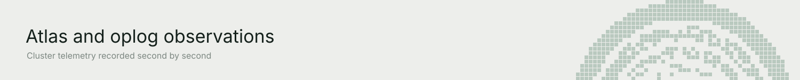

The cluster metrics were sampled every second from `serverStatus` by `atlas_monitor.py`. Gaps in the lines are periods when the cluster could not be reached from the client. As in the Atlas UI, no line is drawn where no sample exists.

### Oplog

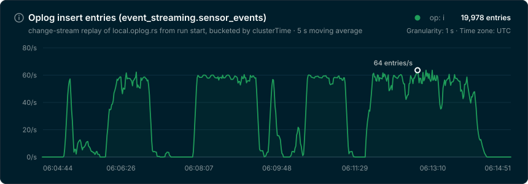

This chart is the most complete view of the run. After the run, `oplog_replay.py` opened a change stream with `startAtOperationTime` set to the run start, and the server replayed every oplog entry for `event_streaming.sensor_events`.

- **19,978 insert entries and 0 entries of any other type.** Each acknowledged `insert_one` produced exactly one oplog entry. Reads add nothing to the oplog, so the pull consumer and the monitor create no replication load.
- **Writes arrived in plateaus of about 60 entries/s, separated by drops to zero.** The five zero periods (06:05:57 for 11 s, 06:07:15 for 9 s, 06:07:29 for 33 s, 06:09:55 for 13 s, 06:11:28 for 18 s) line up with the client-side connection resets. The cluster itself kept running: all 20 sessions resumed on their own and finished.
- **20 sessions × ~2 docs/s is the ceiling for this setup.** Each session waits for a majority acknowledgment (~107 ms at p50) and then sleeps 100 ms. That caps it at about 4.8 docs/s in theory, and 1.9 docs/s in practice once the outages and tail latency are included.

### Opcounters

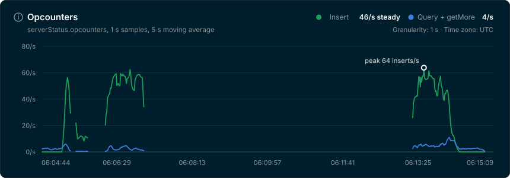

Inserts climb from 0 to about 60/s within two seconds of launch: the 20 processes start within 2.7 s of each other. Reads (`query` + `getMore`) stay at about 4/s, made up of the pull consumer's polls plus the monitor's change stream. The `serverStatus` line has a long gap between 06:06:50 and 06:13:00. In that window the monitor lost its connection during an outage, exited, and was restarted. The oplog chart above covers that window in full.

### Connections

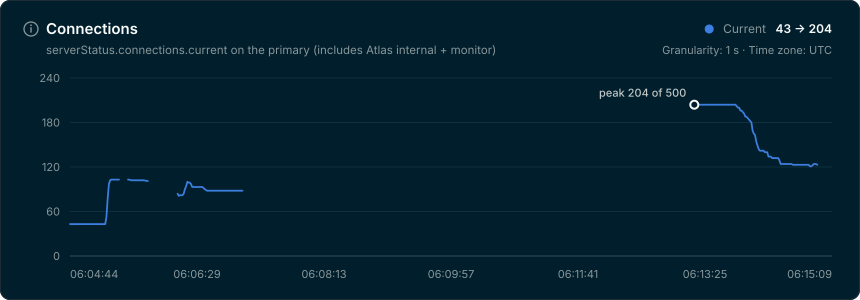

The count rose from 43 to about 100 when the 20 producers connected. Each `MongoClient` holds an application socket plus monitoring connections to every node. After the network resets, the count climbed to **204**. Clients opened new sockets while the server had not yet expired the old ones, and the count fell back toward 120 only once the orphaned sockets timed out. That is still far below the M0 limit of 500, but it shows that each reset briefly doubles connection usage.

### Network

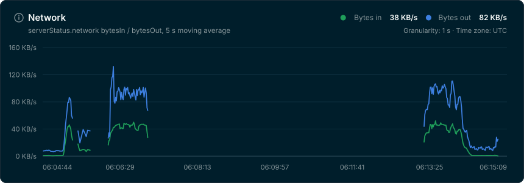

Bytes in averaged 38 KB/s, consistent with about 46 inserts/s of documents averaging about 0.8 KB on the wire. Bytes out (82 KB/s) is higher than bytes in. The change stream and the pull consumer each read every document back, so in this test reads cost more bandwidth than writes.

### Replication lag

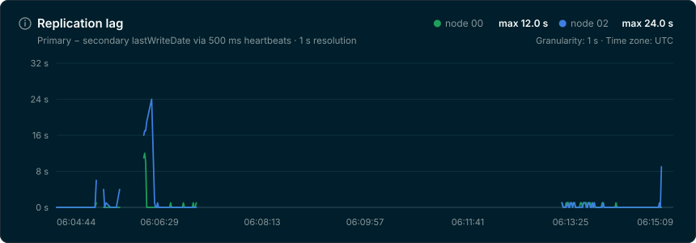

Lag is the difference between the primary's and a secondary's `lastWriteDate`, taken from the driver's 500 ms heartbeats. Atlas reports `lastWriteDate` in whole seconds, so this is a coarse measure. While the client was connected, the median lag was **0 s** and the p95 was **1 s**. The 12 s and 24 s spikes coincide with the outage windows. They show the driver holding a stale heartbeat for a node it could not reach, not secondaries actually falling behind.

### Pull consumer


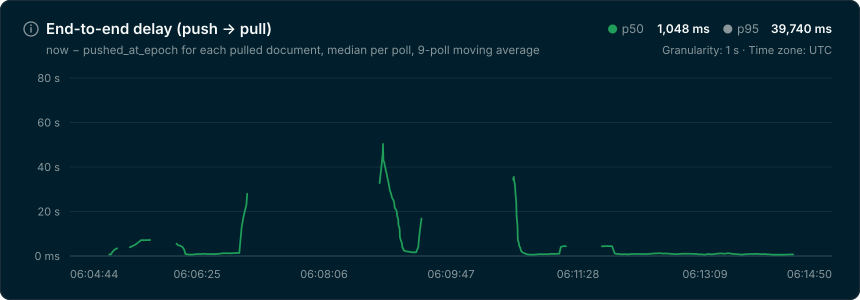

When the network was healthy, a poll took about 265 ms round trip and a document reached the consumer about 1 s after it was created: half a poll interval plus one round trip. After each outage the consumer had a backlog. The end-to-end delay rose to 20–50 s while it drained, which is what pushes the p95 to 39.7 s.

### Insert latency by session

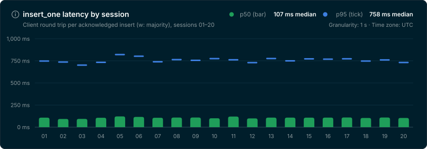

All 20 sessions behaved the same way: p50 between 93 and 121 ms, p95 between 702 and 821 ms. No session was starved and there were no hot spots. The roughly 7× gap between p50 and p95 comes from majority-write acknowledgment across the replica set, combined with the shared-tier (M0) proxy.

### Data integrity

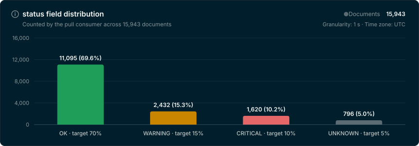

<table width="100%">
  <tr><th width="360" align="left">Field</th><th width="240" align="right">Expected mean</th><th width="240" align="right">Observed mean</th></tr>
  <tr><td align="left"><code>temperature</code></td><td align="right">37.50 °C</td><td align="right">37.44 °C</td></tr>
  <tr><td align="left"><code>humidity</code></td><td align="right">55.00 %</td><td align="right">54.76 %</td></tr>
  <tr><td align="left"><code>pressure</code></td><td align="right">1,000.00 hPa</td><td align="right">1,000.19 hPa</td></tr>
  <tr><td align="left"><code>voltage</code></td><td align="right">4.000 V</td><td align="right">4.007 V</td></tr>
  <tr><td align="left"><code>cpu_usage</code></td><td align="right">50.00 %</td><td align="right">50.25 %</td></tr>
  <tr><td align="left"><code>latency_ms</code></td><td align="right">250.50 ms</td><td align="right">248.73 ms</td></tr>
  <tr><td align="left"><code>signal_strength</code></td><td align="right">−65.0 dBm</td><td align="right">−65.07 dBm</td></tr>
</table>

These means come from the 15,943 documents the consumer received. They match the generator's distributions, so the documents arrive intact. The missing 20% is a delivery problem, not a data problem.


#### Finding 1: polling on `_id` loses documents under concurrent producers

The consumer received 15,943 documents, but the oplog holds 19,978. `ObjectId`s are generated by each client: a timestamp in seconds, a per-process random value, and a counter. Within any one second, the 20 processes produce interleaved `_id`s that do not match commit order. When the consumer advances its bookmark past a high `_id`, any document with a lower `_id` that commits afterwards is never returned. The change-stream replay of the same window returned all 19,978.

**Recommendation:** have the consumer read from a change stream (`collection.watch()`, which is supported on M0) and store its resume token. If polling is required, poll on a server-assigned, monotonic field rather than a client-generated `_id`.

#### Finding 2: the client network, not the cluster, limited this run

All 22 failed inserts and all 84 s of zero-write time were connection resets or timeouts on the client side. Writes from every session resumed as soon as connectivity returned, and the cluster never rejected a write.

**Recommendation:** keep `retryWrites=true` (already on). Add a retry with backoff around `insert_one`, keyed on `event_id`, so the 0.11% of inserts that were lost become retries. Run sustained tests from a host in the same cloud region as the cluster.

#### Finding 3: one round trip per document caps throughput

At about 107 ms per majority-acknowledged insert, a single-threaded producer cannot exceed about 9 docs/s, and with the 100 ms sleep about 4.8 docs/s.

**Recommendation:** batch with `insert_many(ordered=False)` (for example 100 documents per call). This cuts round trips and oplog-related overhead per document by about 100×.

#### Finding 4: connection count doubles after a network reset

Connections went from about 100 to 204 after the resets, and stayed high until the server expired the dead sockets.

**Recommendation:** share one `MongoClient` per process (already the case), set `maxPoolSize` to match real concurrency, and alert on connection count. On M0, 20 producers plus a reset storm uses about 40% of the limit.


```bash
git clone https://github.com/pradhan-not-found/oplog-stream.git
cd oplog-stream
pip install -r requirements.txt
cp .env.example .env        # set MONGO_URI to your Atlas SRV string
```

Add your client's public IP under **Atlas → Security → Network Access**. A missing entry shows up as `SSL handshake failed: TLSV1_ALERT_INTERNAL_ERROR`.

Run the whole test with one command:

```bash
python run_simulation.py --sessions 20 --total 1000 --interval 0.1
```

This writes `results/*.json[l]`, replays the oplog, and regenerates every chart. To run the pieces separately (for example, the consumer on a different machine):

```bash
python pull_script.py --batch 100 --interval 1.0            # pull environment
python launch_sessions.py --sessions 20 --total 1000 --no-window   # push environment
python atlas_monitor.py --until-idle 30                     # observer
python oplog_replay.py && python generate_graphs.py         # report
```

`generate_banner.py`, `generate_headers.py` and `generate_architecture.py` rebuild the banner, the section strips and the architecture diagram. Instrument Sans (SIL Open Font License) is embedded in every SVG as a subset WOFF2, so the typography renders the same on GitHub. To regenerate with the font, place InstrumentSans-400/500/600.woff2 in `assets/fonts/`; without them the generators fall back to the system sans-serif.


Each document has 3 metadata fields (`event_id`, `timestamp`, `pushed_at_epoch`) and 20 generated variables:

<table width="100%">
  <tr><th width="6%" align="center">#</th><th align="left">Field</th><th align="left">Type</th><th align="left">Range / values</th></tr>
  <tr><td align="left">1</td><td align="left"><code>session_id</code></td><td align="left">int</td><td align="left">1 – 20</td></tr>
  <tr><td align="left">2</td><td align="left"><code>sequence</code></td><td align="left">int</td><td align="left">1 – 1,000 per session</td></tr>
  <tr><td align="left">3</td><td align="left"><code>device_id</code></td><td align="left">string</td><td align="left"><code>dev-{session:02d}-{seq:06d}</code></td></tr>
  <tr><td align="left">4</td><td align="left"><code>device_type</code></td><td align="left">string</td><td align="left">sensor, gateway, edge_node, controller, actuator</td></tr>
  <tr><td align="left">5</td><td align="left"><code>region</code></td><td align="left">string</td><td align="left">us-east-1, eu-west-1, ap-south-1, us-west-2, sa-east-1</td></tr>
  <tr><td align="left">6</td><td align="left"><code>temperature</code></td><td align="left">float</td><td align="left">−10.0 to 85.0 °C</td></tr>
  <tr><td align="left">7</td><td align="left"><code>humidity</code></td><td align="left">float</td><td align="left">10.0 to 100.0 %</td></tr>
  <tr><td align="left">8</td><td align="left"><code>pressure</code></td><td align="left">float</td><td align="left">950.0 to 1050.0 hPa</td></tr>
  <tr><td align="left">9</td><td align="left"><code>voltage</code></td><td align="left">float</td><td align="left">3.000 to 5.000 V</td></tr>
  <tr><td align="left">10</td><td align="left"><code>current</code></td><td align="left">float</td><td align="left">0.050 to 2.500 A</td></tr>
  <tr><td align="left">11</td><td align="left"><code>cpu_usage</code></td><td align="left">float</td><td align="left">0.0 to 100.0 %</td></tr>
  <tr><td align="left">12</td><td align="left"><code>memory_usage</code></td><td align="left">float</td><td align="left">0.0 to 100.0 %</td></tr>
  <tr><td align="left">13</td><td align="left"><code>disk_usage</code></td><td align="left">float</td><td align="left">0.0 to 100.0 %</td></tr>
  <tr><td align="left">14</td><td align="left"><code>packet_loss</code></td><td align="left">float</td><td align="left">0.00 to 10.00 %</td></tr>
  <tr><td align="left">15</td><td align="left"><code>latency_ms</code></td><td align="left">float</td><td align="left">1.0 to 500.0 ms</td></tr>
  <tr><td align="left">16</td><td align="left"><code>signal_strength</code></td><td align="left">int</td><td align="left">−100 to −30 dBm</td></tr>
  <tr><td align="left">17</td><td align="left"><code>error_code</code></td><td align="left">int</td><td align="left">0, 1, 2, 3, 404, 500, 503</td></tr>
  <tr><td align="left">18</td><td align="left"><code>protocol</code></td><td align="left">string</td><td align="left">MQTT, CoAP, HTTP, WebSocket, AMQP</td></tr>
  <tr><td align="left">19</td><td align="left"><code>payload_size_kb</code></td><td align="left">float</td><td align="left">0.10 to 64.00 KB</td></tr>
  <tr><td align="left">20</td><td align="left"><code>status</code></td><td align="left">string</td><td align="left">OK 70%, WARNING 15%, CRITICAL 10%, UNKNOWN 5%</td></tr>
</table>


```
oplog-stream/
├── push_script.py        producer: 20-variable documents, per-insert latency
├── launch_sessions.py    starts N producer processes
├── pull_script.py        consumer: _id bookmark polling, per-poll records
├── atlas_monitor.py      serverStatus, oplog change stream, replication lag
├── oplog_replay.py       re-reads the run window from local.oplog.rs
├── run_simulation.py     one-command test orchestration
├── generate_graphs.py    charts + results/summary.json from recorded data
├── generate_banner.py    banner
├── generate_headers.py   section heading strips
├── generate_architecture.py  architecture diagram
├── mosaic.py             pixel-mosaic arch shared by banner and strips
├── svg_theme.py          palette and embedded Instrument Sans
├── results/              raw data from the recorded run
└── assets/               banner, section strips, architecture, charts
```
